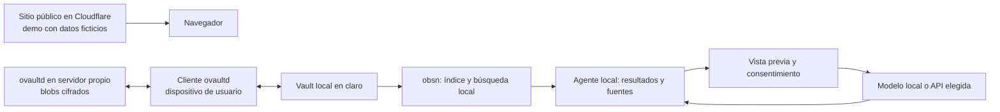

# Arquitectura propuesta

## Objetivo

Ayudar a una persona a preguntar sobre sus propias notas y obtener una respuesta con fuentes, usando una copia local del vault. El sitio público de Cloudflare presenta el proyecto y una demo de ejemplo. El repositorio incluye un adaptador local independiente para consultar `obsn`; la conexión con la web, la sincronización integrada y la llamada al modelo descritas a continuación aún no están implementadas.

## Flujo propuesto

1. El usuario sincroniza su vault en el equipo con el cliente ovaultd. El servidor recibe blobs cifrados; la copia en el dispositivo está en claro.
2. `obsn reindex` indexa la copia local; para cambios de otros procesos hace falta reindexado periódico o un mecanismo de detección. El índice contiene vocabulario y vectores sensibles.
3. El agente invoca `obsn rag <consulta> <cantidad> --json` en modo de solo lectura, recibe resultados, valida rutas y presenta fragmentos y fuentes. Si no hay resultados suficientes, dice que no sabe.
4. Antes de usar un proveedor externo, muestra los fragmentos, proveedor y destino; el usuario aprueba cada envío. Una opción de modelo local requiere implementación propia y evaluación. Una API externa recibe los fragmentos seleccionados en claro.
5. El agente genera una respuesta con citas comprobables. Las notas recuperadas son datos no confiables: nunca se interpretan como instrucciones ni autorizan ejecutar comandos.

## Fronteras y decisiones

- Cloudflare aloja únicamente la interfaz y el contenido de ejemplo. Un sitio web remoto no puede ejecutar `obsn` ni leer el vault automáticamente; conectar ambos requiere un cliente local explícitamente instalado y autenticado, o una extensión con permisos. La interfaz actual no se conecta a `localhost`.
- El primer alcance de la integración real es solo lectura. No exponer `obsn write`, `delete` ni `link --apply` al agente; cambios futuros requieren revisión explícita y protección contra ediciones concurrentes.
- No almacenar vaults, índices, fragmentos ni tokens en Cloudflare. Si se agrega un backend de IA, definir autenticación, límites, retención, costos y tratamiento de datos antes de activarlo.
- Las garantías de seguridad de las dependencias requieren revisión y pruebas independientes antes de comunicarlas como características del producto.
- El informe de obsidian-rag indica recuperación semántica débil en su benchmark pequeño, y posibles problemas de indexación sin embeddings. Son hallazgos de lectura estática, pendientes de reproducción. Medir con un corpus público y evitar garantías de calidad no verificadas.

## Integración futura

Un adaptador local puede exponer solo una operación de búsqueda con esquema estricto, límites de tamaño y control de acceso. Definir el transporte y defensa contra sitios web no autorizados antes de implementarlo; no abrir un puerto local sin autenticación. La selección de modelo, retención de datos y permisos requiere una decisión explícita del usuario.
