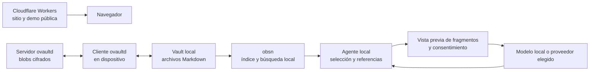

# Propuesta: Bóveda Agente

## La idea

Un asistente que ayuda a encontrar y entender información de una bóveda de Obsidian. Ante una pregunta, busca en las notas de la persona, muestra los fragmentos utilizados y responde con referencias que permiten verificar de dónde salió cada afirmación.

**Pitch:** «Tu conocimiento personal, disponible para un agente que muestra sus fuentes y te deja decidir qué compartir».

Esta es una propuesta para validar con usuarios. El prototipo publicado hoy es una página de presentación con una búsqueda simple sobre notas ficticias. No incorpora todavía un agente, un modelo de IA, `obsn` ni sincronización con ovaultd.

## Problema y usuarios

Quien acumula notas de reuniones, decisiones y documentación puede recordar la idea pero no el título o las palabras exactas. Revisar archivos manualmente toma tiempo y una respuesta sin referencias puede mezclar hechos o inventar detalles.

El primer público son personas que ya usan Obsidian y desean recuperar contexto de reuniones, proyectos o documentación técnica. La frecuencia del problema y la disposición a usar una herramienta adicional son hipótesis; hay que hablar con usuarios antes de asumirlas.

## Experiencia propuesta

1. Instalar y configurar el cliente local con una bóveda de Obsidian de prueba.
2. Indexar las notas con `obsn` y comprobar el estado del índice.
3. Escribir una pregunta: «¿Qué decisiones tomamos sobre el despliegue?».
4. Ver las notas y fragmentos recuperados, con su ruta. Si no hay evidencia suficiente, recibir un mensaje claro.
5. Si se elige un modelo externo, revisar qué fragmentos se enviarán y aprobar el envío. También se podría elegir un modelo local cuando exista una integración probada.
6. Obtener una respuesta con referencias a los fragmentos y abrir las notas para comprobarla.

Si la persona usa ovaultd, su cliente sincroniza la bóveda entre dispositivos. El asistente consulta la copia local en claro; no lee directamente los blobs cifrados del servidor. ovaultd y obsidian-rag siguen siendo proyectos independientes y la sincronización es opcional para probar la búsqueda.

### Ejemplos de uso

- **Reuniones:** «¿Qué acordamos sobre el presupuesto?» → respuesta con las notas de reuniones que respaldan cada acuerdo.
- **Trabajo pendiente:** «¿Qué quedó para la próxima semana?» → resumen de pendientes y citas, incluyendo fechas si aparecen en las notas.
- **Documentación técnica:** «¿Cómo resolvimos el error de conexión?» → fragmentos relevantes, respuesta con fuente y aviso si la evidencia no alcanza.
- **Decisiones contradictorias:** «¿Qué proveedor elegimos?» → mostrar versiones discrepantes y sus fechas; no elegir una como verdadera sin evidencia.

## Arquitectura

Cloudflare sirve la presentación pública. Una página web no obtiene por sí sola acceso a los archivos locales ni ejecuta `obsn`: la solución real necesita un componente local instalado con un canal de acceso autenticado y restricciones explícitas. El transporte, el empaquetado y la integración con Codex todavía deben definirse y probarse. No debe exponerse un servicio local sin protección frente a otros sitios web.

El índice de `obsn` se mantiene en el dispositivo y debe tratarse como sensible: contiene vocabulario y vectores derivados de las notas. Si se usa una API externa, los fragmentos aprobados se envían en claro al proveedor seleccionado, sujeto a sus condiciones. No hace falta subir todo el vault a Cloudflare.

## Alcance de la primera versión funcional

### Imprescindible

- Conectar una bóveda local configurada y mostrar si el índice está listo, incompleto o desactualizado.
- Buscar en modo de solo lectura y mostrar rutas y fragmentos verificables.
- Manejar consultas sin resultados sin inventar una respuesta.
- Permitir revisar el contexto y autorizar cada envío a un proveedor remoto; cancelar no envía los fragmentos.
- Generar respuestas con referencias que correspondan a resultados recuperados y reconocer incertidumbre.
- Tratar el contenido de las notas como datos: no ejecutar instrucciones que aparezcan dentro de ellas.

### Para después

Edición automática de notas, acceso compartido entre usuarios, sincronización de índices, modelos locales integrados y soporte móvil requieren decisiones y pruebas adicionales. La primera versión no depende de esas funciones.

## Estado y riesgos conocidos

- **Demo:** la página pública usa coincidencia de palabras en tres notas ficticias; no es todavía la solución descrita.
- **Recuperación:** el análisis estático de obsidian-rag registra debilidad en paráfrasis y un benchmark pequeño sobre un vault privado. Crear un corpus público de evaluación antes de prometer calidad o cambiar de modelo.
- **Índice:** el análisis señala un posible caso en que faltan vectores y el índice queda listo. Hay que reproducirlo y resolverlo antes de basar respuestas en él.
- **Integridad:** las garantías de seguridad de la sincronización requieren revisión y pruebas independientes antes de presentarlas como características del producto.
- **Escrituras y concurrencia:** el análisis de obsidian-rag advierte que una edición concurrente podría sobrescribirse. El agente inicial tendrá acceso solo de lectura.
- **Datos sensibles:** vista previa, consentimiento, permisos y retención dependen del proveedor y del diseño definitivo. El servidor de sincronización puede guardar contenido cifrado, pero el dispositivo y cualquier proveedor autorizado procesan fragmentos en claro.

Los análisis mencionados son lecturas estáticas; sus hallazgos deben reproducirse y no equivalen a auditorías externas.

## Cómo medir si sirve

Para una primera validación, proponer estos objetivos como hipótesis, no como resultados:

- **Comprensión:** al menos 4 de 5 participantes pueden identificar la nota fuente de una respuesta durante una sesión guiada.
- **Utilidad:** al menos 3 de 5 completan una búsqueda de contexto útil y dicen que la usarían de nuevo. Registrar también por qué no la usarían.
- **Recuperación:** construir un corpus sintético abierto con preguntas y notas relevantes etiquetadas; medir recall@5 y MRR, incluyendo preguntas sin respuesta. Establecer una línea de base antes de fijar un objetivo de mejora.
- **Consentimiento:** comprobar que cancelar la vista previa no genera ninguna solicitud al proveedor. Validarlo con pruebas de integración, no con métricas que registren notas privadas.

Recoger comentarios con consentimiento y sin guardar contenido de bóvedas personales. Una muestra pequeña orienta las siguientes pruebas; no demuestra adopción general.

## Etapas

1. **Presentar el concepto:** usar la demo actual, recopilar comentarios y confirmar qué pregunta resolvería cada participante.
2. **Evaluar búsqueda:** preparar corpus público, reproducir los hallazgos sobre índice y comparar calidad de recuperación con mediciones repetibles.
3. **Integrar localmente:** conectar `obsn` en modo de solo lectura, con estado del índice, fuentes y errores claros.
4. **Incorporar IA:** integrar un proveedor elegido o un modelo local, con vista previa, consentimiento y pruebas de respuestas con citas.
5. **Validar sincronización:** revisar las garantías de ovaultd y probar dos dispositivos, conflictos y comportamiento ante datos alterados.

La fecha y el esfuerzo de cada etapa dependen de las decisiones técnicas y de la disponibilidad de quienes participen. Los criterios detallados de implementación están en [plan.md](plan.md).

## Decisiones abiertas

- ¿El usuario interactúa desde un cliente local, un plugin de Obsidian o Codex con una herramienta local? Definir según una prueba de uso y la seguridad del transporte.
- ¿Qué modelo o proveedor se quiere utilizar, y cuánto se acepta gastar? Medir calidad, costo y manejo de datos antes de elegir.
- ¿Cuál es el sistema operativo inicial y cómo se instala el componente local? Elegir el menor alcance que permita una demo real.
- ¿Se necesita una bóveda sincronizada para la primera prueba con usuarios o alcanza con una carpeta local de ejemplo? La opción local reduce dependencias iniciales.

## Presentación para el hackathon

**Problema:** tengo notas útiles, pero recuperar el contexto lleva tiempo.  
**Propuesta:** un agente consulta mis notas y explica de dónde obtiene la respuesta.  
**Demo actual:** buscar en datos ficticios desde la web.  
**Próximo paso:** conectar una bóveda local de prueba, medir recuperación y agregar respuestas con fuentes y consentimiento.
